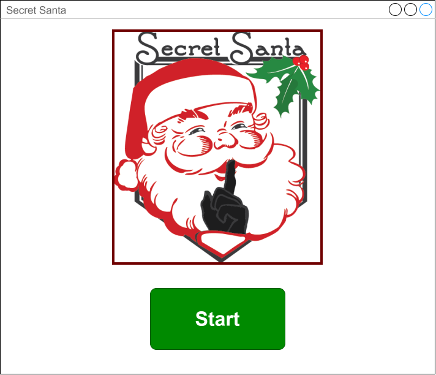
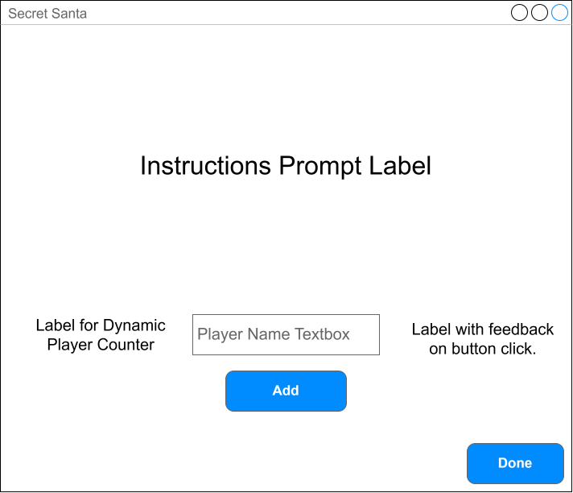
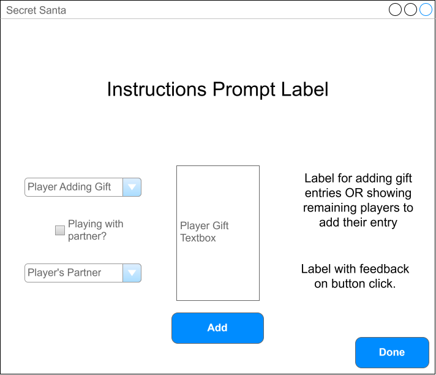
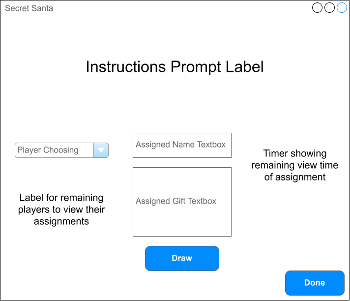

# Storyboard: Secret Santa Application
This document serves as a visual to map the page layouts and the relationships between each
page, diagraming the interactivity for the Secret Santa application. Outlining the flow between
the initial setup screen to the final assignment window facilitates a blueprint for the
application's architecture and user experience.

## Screen 1: Setup

## Screen 2: Adding Players

#### **Note**: Potential UX = one person adds all players to Santa bag vs. each player individually adding themselves

## Screen 3: Adding Gifts / Partners

## Screen 4: Secret Santa Assignment

### Interactivity Diagram
**Screen 1** -> **Screen 2** -> **Screen 3** -> **Screen 4**